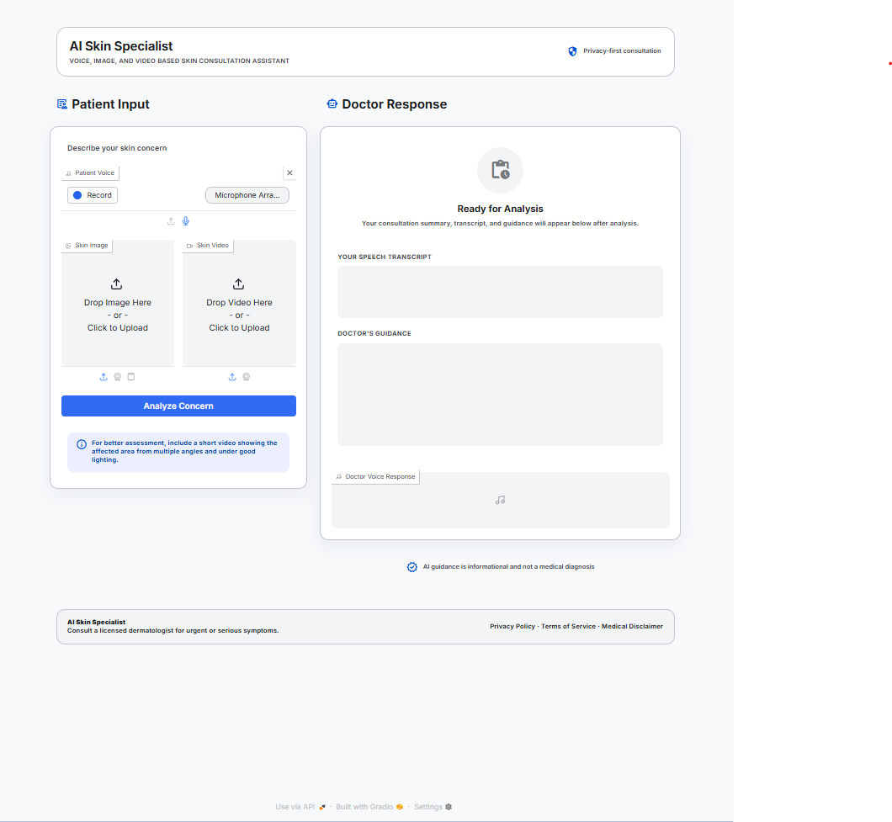
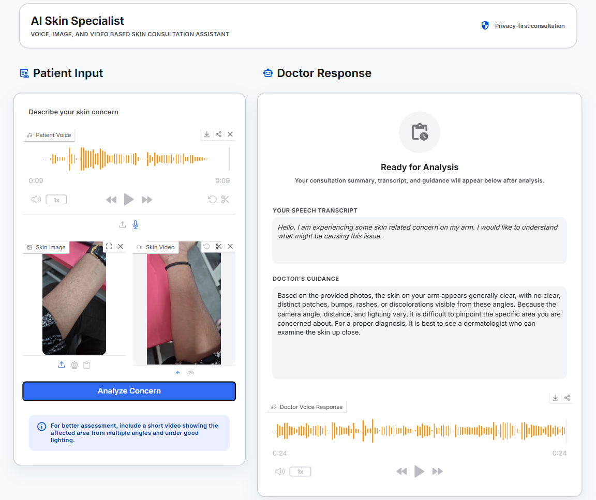

# 🩺 AI Skin Specialist

### AI-Powered Skin Consultation Assistant Using Voice, Images, and Video

AI Skin Specialist is an AI-powered web application designed to help users understand skin-related concerns through voice descriptions, skin images, and video input.

The application combines artificial intelligence, computer vision, speech recognition, and text-to-speech technology to provide an interactive skin consultation experience.

---

## 🌐 Live Demo

Try the deployed application:

### 🚀 [AI Skin Specialist – Open Live Website](https://ai-skin-specialist-30cg.onrender.com)

**Hosting Platform:** Render  
**Deployment Status:** Live

---

##  Application Preview

### Main Application Interface



### AI Consultation and Doctor Response



---

##  Key Features

- **🎙️ Patient Voice Input:** Record or upload voice descriptions of skin-related concerns.
- **🖼️ Skin Image Analysis:** Upload skin images for AI-powered visual analysis.
- **🎥 Skin Video Analysis:** Provide videos to give additional visual context.
- **📝 Speech-to-Text:** Convert patient voice recordings into text using Groq Whisper.
- **🤖 AI-Powered Analysis:** Generate contextual responses using Groq AI models.
- **🔊 Doctor Voice Response:** Convert the generated text response into spoken audio using Deepgram TTS.
- **💻 Interactive Web Interface:** Simple and responsive interface built with Gradio.
- **🔐 API Key Management:** Keep API credentials separate from application source code using environment variables.

---

##  Technology Stack

| Technology | Purpose |
|---|---|
| Python | Core programming language |
| Gradio | Web application interface |
| Groq API | AI-powered processing |
| Groq Whisper | Speech-to-text transcription |
| Deepgram API | Text-to-speech generation |
| OpenCV | Video processing |
| NumPy | Numerical operations |
| Pillow | Image processing |
| python-dotenv | Environment variable management |
| uv | Python package and dependency management |
| Render | Cloud hosting and deployment |
| Git & GitHub | Version control and source code management |

---

##  Project Structure

```text
ai-skin-specialist/
│
├── main.py
│
├── app_logging.py
│
├── brain_of_the_doctor_groq.py
│
├── voice_of_the_patient.py
│
├── voice_of_the_doctor.py
│
├── media_validation.py
│
├── doctor_response.mp3
│
├── pyproject.toml
│
├── uv.lock
│
├── README.md
│
├── .gitignore
│
└── .env
```

**Note:** The `.env` file contains private API credentials and must never be uploaded to GitHub.

---

##  Requirements

Before running the project locally, make sure you have:

- Python 3.12 or newer compatible with the project dependencies.
- uv package manager.
- Git.
- A Groq API key.
- A Deepgram API key.

---

##  Installation and Setup

### 1. Clone the Repository

```bash
git clone https://github.com/purbasha4u/ai-skin-specialist.git
```

### 2. Navigate to the Project Directory

```bash
cd ai-skin-specialist
```

### 3. Install Dependencies

Install the required dependencies using uv:

```bash
uv sync
```

This command creates the virtual environment and installs the packages specified in `pyproject.toml` and `uv.lock`.

### 4. Configure Environment Variables

Create a `.env` file in the project's root directory.

Add the following variables:

```env
GROQ_API_KEY=your_groq_api_key
DEEPGRAM_API_KEY=your_deepgram_api_key
```

Replace the placeholder values with your actual API credentials.

**Important:** Never share your API keys or commit your `.env` file to GitHub.

### 5. Run the Application

Start the application using:

```bash
uv run python main.py
```

Open your browser and visit:

```text
http://127.0.0.1:7861
```

---

##  Application Workflow

The application follows this general workflow:

```text
        Patient Input
              |
     ---------------------
     |         |         |
   Voice     Image     Video
     |         |         |
     v         v         v
  Whisper   Image      Video
 Transcription Analysis Processing
     |         |         |
     --------- | ---------
               |
               v
        AI Processing
          (Groq API)
               |
               v
       Doctor's Guidance
               |
          -------------
          |           |
          v           v
      Text Output   Deepgram TTS
                        |
                        v
                  Voice Response
```

### Workflow Explanation

1. The patient provides a voice description, skin image, or video.
2. The voice recording is converted into text using Groq Whisper.
3. Image and video inputs are processed to extract relevant visual information.
4. The collected information is sent to the AI model through Groq.
5. The application generates a contextual response.
6. Deepgram converts the generated response into spoken audio.
7. The results are displayed in the Gradio interface.

---

##  Deployment

The application is deployed on **Render** as a Python Web Service.

### Live Application

[https://ai-skin-specialist-30cg.onrender.com](https://ai-skin-specialist-30cg.onrender.com)

### Deployment Configuration

| Configuration | Value |
|---|---|
| Hosting Platform | Render |
| Service Type | Web Service |
| Runtime | Python 3.12 |
| Framework | Gradio |
| Package Manager | uv |
| Deployment Branch | main |
| Instance Plan | Free |

### Build Command

```bash
uv sync --frozen && uv cache prune --ci
```

### Start Command

```bash
python main.py
```

### Environment Variables

Configure the following variables in Render:

```text
GROQ_API_KEY
DEEPGRAM_API_KEY
PYTHON_VERSION
```

Never store API credentials directly in the source code or public repository.

---

##  Security and Privacy

The application uses environment variables to manage API credentials.

Important security practices:

- Keep API keys in a local `.env` file.
- Add `.env` to `.gitignore`.
- Configure production API keys through Render Environment Variables.
- Never publish API credentials in source code, screenshots, or documentation.
- Avoid uploading sensitive personal information.

Voice recordings, images, and videos may be processed by external AI service providers. Users should review the relevant providers' privacy policies before submitting personal information.

---

##  Medical Disclaimer

AI Skin Specialist is an experimental AI-powered informational assistant.

The generated responses are intended for educational and informational purposes only.

This application does not provide professional medical diagnosis, treatment, or prescriptions.

AI-generated results may be inaccurate or incomplete. Users should consult a qualified dermatologist or healthcare professional for proper medical evaluation and treatment.

---

##  Future Improvements

- Improve skin image analysis accuracy.
- Add multilingual voice interaction.
- Improve video-based skin analysis.
- Introduce consultation history.
- Enhance the user interface and experience.
- Add secure user authentication.
- Improve application performance and scalability.

---

##  Authors

**Bikram Das & Purbasha Ram**

Developed as an AI-powered application combining artificial intelligence, computer vision, speech recognition, and modern web technologies.

---

##  Support

If you find this project interesting, consider giving the repository a ⭐ on GitHub.

**GitHub Repository:**  
https://github.com/purbasha4u/ai-skin-specialist

**Live Demo:**  
https://ai-skin-specialist-30cg.onrender.com

---

*Built with Python, AI, and a passion for innovation.* 🚀